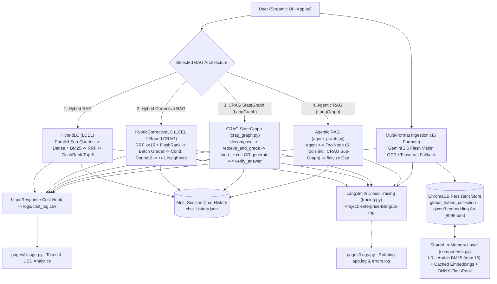
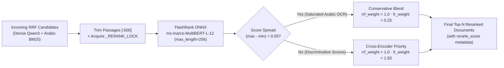
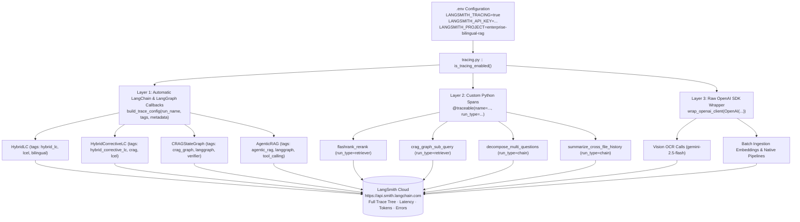
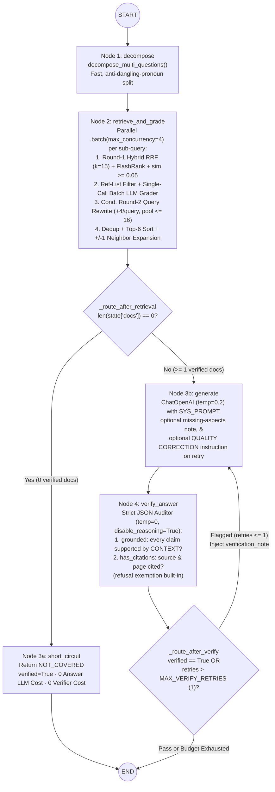
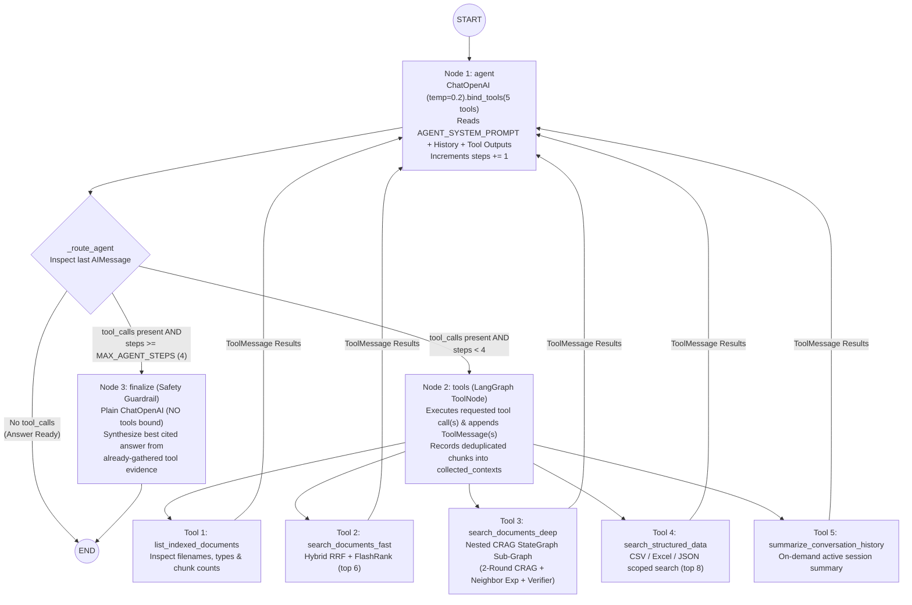

# Enterprise Bilingual RAG Platform — LangChain, LangGraph & LangSmith

[](https://www.python.org/)
[](https://python.langchain.com/)
[](https://langchain-ai.github.io/langgraph/)
[](https://smith.langchain.com/)
[](https://github.com/PrithivirajDamodaran/FlashRank)
[](https://streamlit.io/)
[](https://www.trychroma.com/)

A production-grade, **bilingual (English & Arabic)** Retrieval-Augmented Generation (RAG) platform supporting **four live selectable architectures** — **Hybrid RAG (`HybridLC`)**, **Hybrid Corrective RAG (`HybridCorrectiveLC`)**, **Self-Corrective `CRAG StateGraph` (LangGraph)**, and **Autonomous Tool-Calling `Agentic RAG` (LangGraph)** — backed by **4,096-dim `qwen/qwen3-embedding-8b`**, **light-stemmed Arabic BM25**, **local ONNX FlashRank Multilingual reranking**, **`±1` Neighbor Chunk Expansion**, **Gemini 2.5 Flash Vision OCR**, and **full end-to-end LangSmith tracing**.

> **Active Branch (`LangSmith-&-LangGraph`):** Extends the `langchain` LCEL foundation with full **LangSmith observability**, two **LangGraph stateful/agentic architectures** (`CRAG StateGraph` and `Agentic RAG`), **Gemini 2.5 Flash Vision OCR**, **ONNX FlashRank Multilingual cross-encoder reranking**, **`qwen/qwen3-embedding-8b`** embeddings, upgraded **Arabic BM25**, and **`±1` neighbor expansion** — all selectable live inside the multi-page Streamlit UI (`App.py`).

---

## Table of Contents

- [Key Capabilities](#key-capabilities)
- [End-to-End System Architecture](#end-to-end-system-architecture)
- [Core Retrieval, Reranking & Ingestion Upgrades](#core-retrieval-reranking--ingestion-upgrades)
  - [1. Multilingual Embeddings & Upgraded Arabic BM25](#1-multilingual-embeddings--upgraded-arabic-bm25)
  - [2. Local ONNX FlashRank Multilingual Reranker (Saturation-Aware)](#2-local-onnx-flashrank-multilingual-reranker-saturation-aware)
  - [3. Neighbor Chunk Expansion (`±1`) & Softened CRAG Grader](#3-neighbor-chunk-expansion-1--softened-crag-grader)
  - [4. Fast Self-Contained Multi-Question Decomposition](#4-fast-self-contained-multi-question-decomposition)
  - [5. Vision LLM OCR (Gemini 2.5 Flash) with Tesseract Fallback](#5-vision-llm-ocr-gemini-25-flash-with-tesseract-fallback)
- [LangSmith Observability & Distributed Tracing](#langsmith-observability--distributed-tracing)
- [LangGraph Deep Dive: State Machines & Autonomous Agents](#langgraph-deep-dive-state-machines--autonomous-agents)
  - [Why LangGraph Over Linear Chains?](#why-langgraph-over-linear-chains)
  - [Architecture 3: Self-Corrective `CRAG StateGraph` (`crag_graph.py`)](#architecture-3-self-corrective-crag-stategraph-crag_graphpy)
  - [Architecture 4: Autonomous Tool-Calling `Agentic RAG` (`agent_graph.py`)](#architecture-4-autonomous-tool-calling-agentic-rag-agent_graphpy)
- [LangChain LCEL Pipelines (`HybridLC` & `HybridCorrectiveLC`)](#langchain-lcel-pipelines-hybridlc--hybridcorrectivelc)
- [4-Way Architecture Comparison & Selection Guide](#4-way-architecture-comparison--selection-guide)
- [Multi-Format Ingestion & Bilingual OCR](#multi-format-ingestion--bilingual-ocr)
- [Streamlit Multi-Page Application](#streamlit-multi-page-application)
- [Observability: Cost Tracking, Retries & Logging](#observability-cost-tracking-retries--logging)
- [Project Structure](#project-structure)
- [Getting Started & Full Environment Reference](#getting-started--full-environment-reference)
- [Repository Branch Map](#repository-branch-map)
- [Technology Stack](#technology-stack)

---

## Key Capabilities

- **Four Live RAG Architectures in One UI:** Switch seamlessly in the sidebar between:
  1. **Hybrid RAG (`HybridLC`)** — Fast single-round LCEL Dense + Arabic BM25 + RRF + FlashRank.
  2. **Hybrid Corrective RAG (`HybridCorrectiveLC`)** — 2-round LCEL CRAG with batch LLM grading, conditional query rewriting, neighbor expansion, and zero-cost refusal short-circuiting.
  3. **CRAG StateGraph (`LangGraph`)** — Explicit typed `StateGraph` adding a post-generation **Hallucination & Citation Verifier** with a cyclic self-correction retry loop.
  4. **Agentic RAG (`LangGraph`)** — Autonomous tool-calling agent equipped with **5 specialized tools** (including invoking `CRAG StateGraph` as a deep-research sub-graph) governed by a hard `MAX_AGENT_STEPS = 4` safety guardrail.
- **High-Precision Bilingual English & Arabic Retrieval:** Combines **4,096-dim `qwen/qwen3-embedding-8b`** dense vectors with an upgraded **Arabic-aware `BM25ChunkRetriever`** (diacritics/tatweel removal, Alef/Ya/`ة→ه` folding, Arabic-Indic digit normalization `٠-٩→0-9`, and light prefix stemming), fused via Reciprocal Rank Fusion (`k = 60`), reranked locally with **ONNX FlashRank Multilingual**, and expanded with **`±1` adjacent neighbor chunks**.
- **Full LangSmith Tracing (`hybrid_rag/tracing.py`):** Captures complete hierarchical execution trees across LCEL chains, LangGraph nodes/edges, custom `@traceable` spans (reranking, sub-query retrieval, query decomposition, history summarization), and wrapped OpenAI-SDK calls (Vision OCR & embeddings) with zero-overhead no-op fallback when disabled.
- **15 Supported File Formats + Vision LLM OCR:** Uses **Gemini 2.5 Flash Vision OCR** (`OCR_ENGINE=vision`, `~$0.00020/page`) for high-accuracy verbatim Arabic/English & table transcription on scanned PDFs and standalone images, with automatic offline **Tesseract (`ara+eng`)** fallback.
- **Real-Time Cost Analytics (`Usage`) & Live Log Inspector (`Logs`):** Intercepts every OpenRouter HTTP response (including LangChain, LangGraph, embeddings, Vision OCR, Verifier, and summarizer calls) into `logs/cost_log.csv` with live OpenRouter credit verification and multiline traceback log viewing.

---

## End-to-End System Architecture



---

## Core Retrieval, Reranking & Ingestion Upgrades

### 1. Multilingual Embeddings & Upgraded Arabic BM25

- **Dense Embeddings (`qwen/qwen3-embedding-8b`, 4,096 dims):** Replaced `openai/text-embedding-3-small` (1,536 dims) across the entire global ChromaDB collection (`6,343` chunks across 10 bilingual PDFs) via OpenRouter, dramatically closing the retrieval gap on classical Arabic and scanned OCR books while maintaining **0.00% cross-lingual bleed**.
- **Upgraded Arabic-Aware BM25 (`hybrid_rag/hybrid.py` & `hybrid_rag/lc/components.py`):**
  - Strips Arabic diacritics/harakat and tatweel (`[\u064B-\u065F\u0670\u0640]`).
  - Normalizes character variants: `أ / إ / آ / ٱ -> ا`, `ى -> ي`, and **`ة -> ه`**.
  - Folds Arabic-Indic digits **`٠-٩ -> 0-9`** so numbers/dates match seamlessly across OCR and modern queries.
  - Applies **light Arabic prefix stemming** (`ال`, `و`, `ب`, `ك`, `ل`, `ف`, compound prefixes like `وال`, `بال`, `كال`, `فال`, `لل`) for words above minimum length thresholds.
- **LRU Bounded BM25 Cache (`MAX_BM25_CACHE = 16`) & Parallel Sub-Queries:** `bm25_retriever()` uses an `OrderedDict` LRU cache keyed by `(corpus_count, file_filter, k)` so memory stays bounded regardless of file-filter combinations, while `hybrid_search()` executes dense + BM25 retrieval concurrently across sub-questions via `ThreadPoolExecutor`.

### 2. Local ONNX FlashRank Multilingual Reranker (Saturation-Aware)

Implemented in [`hybrid_rag/lc/components.py`](hybrid_rag/lc/components.py) (`get_reranker()`, `rerank_documents()`):

- Runs **`ms-marco-MultiBERT-L-12`** locally on CPU via **FlashRank ONNX** (`models/flashrank_cache/`, ~98 MB — zero PyTorch, zero GPU, zero extra API spend).
- **Thread-Safe & Speed-Optimized:** Uses a module-level `_RERANK_LOCK` to prevent ONNX CPU thread thrashing under concurrent workloads, `max_length=256`, `[:600]` passage trimming, `pool_limit = max(top_n * 2, 12)` in `hybrid_search()`, and **Round-1-only reranking** in CRAG (`via_label == "question"`).
- **Saturation-Aware RRF Fusion:** Multilingual cross-encoders can produce compressed/saturated logits (`0.996–0.999`) on noisy classical Arabic OCR. Instead of blindly discarding RRF order, `rerank_documents()` inspects the score spread (`max(scores) - min(scores)`):



- Controlled via `.env`: `RERANK_ENABLED=true` and `RERANK_MODEL=ms-marco-MultiBERT-L-12`.

### 3. Neighbor Chunk Expansion (`±1`) & Softened CRAG Grader

- **Neighbor Expansion (`expand_with_neighbors` in `components.py`):** After CRAG grading filters candidates down to a compact verified set (typically `2–4` chunks), the top verified chunks are expanded with up to `max_neighbors = 2` immediate adjacent chunks (`+1` forward continuation first, plus `-1` preceding chunk when only 1 chunk survived) from the **exact same source file** and **same or adjacent page** (`abs(page_a - page_b) <= 1`), while skipping bibliography/reference-list noise. This recovers multi-item lists, tables, and split facts at **zero extra API cost**.
- **Softened `GRADER_PROMPT` (`hybrid_rag/hybrid_corrective.py`):** Retains partially supporting chunks rather than aggressively dropping borderline OCR passages, eliminating false refusals on answerable queries while preserving 95.8% short-circuiting on truly out-of-corpus queries.

### 4. Fast Self-Contained Multi-Question Decomposition

- `decompose_multi_questions()` in [`hybrid_rag/file_processing.py`](hybrid_rag/file_processing.py) runs with `reasoning.enabled = False` for low latency and enforces an explicit **anti-dangling-pronoun rule**: clauses referring to the same entity via pronouns (e.g., *"ما علاقتهما بالمنطق؟"*) are either kept together with their parent question or rewritten with the full entity name repeated so no sub-query ever retrieves generic off-topic chunks.

### 5. Vision LLM OCR (Gemini 2.5 Flash) with Tesseract Fallback

Implemented in [`hybrid_rag/file_processing.py`](hybrid_rag/file_processing.py):

- When `OCR_ENGINE=vision` (default when `OPENROUTER_API_KEY` is present), scanned PDF pages and standalone images are downscaled to max `1800px` (`JPEG` quality `85`), base64-encoded, and transcribed verbatim using **`OCR_VISION_MODEL=google/gemini-2.5-flash`** (`temperature=0.0`, `~$0.00020/page`, `~1.1s/page`) with a dedicated bilingual Arabic/English prompt preserving headings, numbers, Hijri/Gregorian dates, tables, and footnotes.
- Automatically falls back to local **Tesseract OCR (`ara+eng`)** if `OCR_ENGINE=tesseract`, if no OpenRouter key is configured, or if a Vision API call fails.

---

## LangSmith Observability & Distributed Tracing

All tracing is centralized in [`hybrid_rag/tracing.py`](hybrid_rag/tracing.py), providing unified visibility across **three execution layers** (LCEL chains, LangGraph graphs, and raw OpenAI-SDK calls) while degrading gracefully to zero-overhead no-ops whenever tracing is disabled or `langsmith` is not installed.



### Tracing Utilities in [`hybrid_rag/tracing.py`](hybrid_rag/tracing.py)

| Helper | Role | Where It Is Wired |
| :--- | :--- | :--- |
| `is_tracing_enabled()` | Checks `LANGSMITH_TRACING` / `LANGCHAIN_TRACING_V2` and `LANGSMITH_API_KEY` / `LANGCHAIN_API_KEY` | Guard for OpenAI wrapping & runtime checks |
| `traceable(*args, **kwargs)` | Re-exports `langsmith.traceable` with safe no-op fallback if uninstalled | `flashrank_rerank`, `crag_graph_sub_query`, `decompose_multi_questions`, `summarize_cross_file_history` |
| `wrap_openai_client(client)` | Wraps `OpenAI(...)` clients via `langsmith.wrappers.wrap_openai` | `initialize_api()` in `file_processing.py` (covers Vision OCR, decomposition, summarizer, embeddings) |
| `build_trace_config(run_name, tags, metadata)` | Produces a standardized `RunnableConfig` attaching `run_name`, pipeline/language tags, `session_id`, and `selected_files` | `run_hybrid_lc`, `run_hybrid_corrective_lc`, `run_crag_graph`, `run_crag_graph_stateless`, `run_agentic_rag` |

> **Clean Benchmarking:** Bulk evaluation scripts explicitly set `os.environ["LANGSMITH_TRACING"] = "false"` in-process so hundreds of benchmark runs never clutter your production LangSmith project dashboard.

---

## LangGraph Deep Dive: State Machines & Autonomous Agents

### Why LangGraph Over Linear Chains?

While **LangChain LCEL** excels at deterministic, directed acyclic pipelines (`A | B | C`), advanced production RAG requires **cycles, persistent typed state across branches, verification retries, and dynamic tool-calling loops**:

| Capability | LangChain LCEL (`HybridLC` / `HybridCorrectiveLC`) | LangGraph (`CRAG StateGraph` / `Agentic RAG`) |
| :--- | :--- | :--- |
| **Execution Topology** | Linear / branching DAG (`RunnableBranch`) | Explicit **Stateful Graph (`StateGraph`) with Cycles** |
| **State Representation** | Ad-hoc dicts passed between runnables | Strongly typed **`TypedDict` State** (`CRAGState`, `AgentState`) |
| **Self-Correction Loop** | Retrieval-side only (Round-2 rewrite) | **Post-Generation Verification Cycle** (`generate -> verify_answer -> generate`) |
| **Autonomous Tool Routing** | Fixed retrieval path for every query | **Dynamic LLM Tool Selection** (`agent <-> ToolNode`) with hard step-cap (`finalize`) |
| **Composability** | Chain calls chain | **`Agentic RAG` invokes `CRAG StateGraph` as a sub-graph tool** (`search_documents_deep`) |

---

### Architecture 3: Self-Corrective `CRAG StateGraph` (`crag_graph.py`)

Implemented in [`hybrid_rag/lc/crag_graph.py`](hybrid_rag/lc/crag_graph.py), `CRAG StateGraph` upgrades 2-round Corrective RAG into an explicit **5-node cyclic state machine** that not only verifies retrieved evidence *before* generation, but also audits the generated answer for **hallucinations and missing citations** *after* generation and self-corrects when needed.

#### Exact Graph Topology



#### Typed Graph State Schema (`CRAGState`)

| Field | Type | Written By | Purpose |
| :--- | :--- | :--- | :--- |
| `question` | `str` | Caller (`START`) | Original user query |
| `selected_files` | `list[str] \| None` | Caller (`START`) | Sidebar file filter scope (`None` = global DB) |
| `session_id` | `str` | Caller (`START`) | Active chat session ID for memory loading |
| `history_limit` | `int` | Caller (`START`) | Number of recent turns to load (`5` interactive, `0` stateless) |
| `sub_queries` | `list[str]` | `decompose` | Self-contained decomposed sub-questions |
| `docs` | `list[Document]` | `retrieve_and_grade` | Deduplicated, graded, neighbor-expanded chunks (capped at `MAX_CONTEXT = 6`) |
| `missing` | `str` | `retrieve_and_grade` | Aggregated aspects not covered by retrieved documents |
| `statuses` | `list[str]` | `retrieve_and_grade` | Per-sub-query status (`CORRECT`, `CORRECTED`, `PARTIAL`, `NOT FOUND`) |
| `round2_triggered` | `bool` | `retrieve_and_grade` | Whether any sub-query triggered Round-2 corrective rewriting |
| `context` | `str` | `retrieve_and_grade` | Formatted `[Source: ... | Page ...]` context block |
| `history` | `list` | `retrieve_and_grade` | Loaded LangChain `HumanMessage`/`AIMessage` rolling history |
| `answer` | `str` | `short_circuit` / `generate` | Final or draft assistant answer |
| `verified` | `bool` | `short_circuit` / `verify_answer` | Whether the answer passed grounding + citation verification |
| `verification_note` | `str` | `short_circuit` / `verify_answer` | Actionable feedback injected into `generate` during self-correction |
| `retries` | `int` | `verify_answer` | Self-correction loop counter (bounded by `MAX_VERIFY_RETRIES = 1`) |

#### Detailed Node & Edge Behavior

1. **`decompose_node`:** Splits compound or numbered prompts into self-contained sub-queries (`decompose_multi_questions`).
2. **`retrieve_and_grade_node`:** Runs `_retrieve_sub_query()` in parallel via `RunnableLambda(...).batch(..., config={"max_concurrency": 4})`:
   - **Round 1:** Fetches `INITIAL_CANDIDATES = 15` via `search_hybrid_rrf_lc` (Qwen3 Dense + Arabic BM25 + RRF + saturation-aware FlashRank), applies cosine floor (`MIN_SIMILARITY = 0.05`), removes bibliography/reference noise (`_is_reference_doc`, exempting structured CSV/Excel/JSON chunks), and calls the single-shot batch JSON grader (`grade_documents_lc`).
   - **Round 2 (Conditional):** Triggered *only* when Round 1 is insufficient. Batch-embeds the grader's rewritten queries, retrieves `EXTRA_PER_QUERY = 4` new candidates per query (without redundant FlashRank overhead), deduplicates, re-scores exact cosine similarity against the original sub-query embedding, and re-grades the merged pool (`MAX_GRADED = 16`).
   - **Merge & Expand:** Deduplicates verified docs across sub-queries by `chunk_id`, keeps top `MAX_CONTEXT = 6`, applies `expand_with_neighbors(max_total=6, max_neighbors=2)`, and loads session chat history.
3. **`_route_after_retrieval` -> `short_circuit_node` vs `generate_node`:**
   - If `docs` is empty, **`short_circuit_node`** returns `NOT_COVERED` immediately with **0 Answer LLM calls and 0 Verifier calls** (triggered on **95.8% [23/24]** of out-of-corpus questions in benchmarks at `$0.00054/Q`).
   - Otherwise, **`generate_node`** synthesizes a grounded, cited reply using `SYS_PROMPT`, appending any `missing` aspect disclosure and — on retry turns — an explicit `QUALITY CORRECTION REQUIRED` block carrying `verification_note`.
4. **`verify_answer_node` & `_route_after_verify`:**
   - Audits the draft answer with `VERIFIER_TEMPLATE | get_llm(temperature=0.0, disable_reasoning=True)` returning strict JSON `{"grounded": bool, "has_citations": bool, "issue": str}`.
   - Includes a **refusal exemption** so accurate *"not found in the database"* answers are never falsely flagged for lacking page citations.
   - Fails open on transient verifier errors so user latency is never broken.
   - If flagged (`grounded=False` or `has_citations=False`) and `retries <= MAX_VERIFY_RETRIES (1)`, routes back to `generate_node` to self-correct once; otherwise terminates at `END`.
5. **Dual Public Runners:**
   - **`run_crag_graph(...)`:** Stateful runner wired to `App.py` — loads session history, runs compiled singleton `get_crag_graph()`, traces to LangSmith (`run_name="CRAGStateGraph"`), and persists the turn to `chat_history.json`.
   - **`run_crag_graph_stateless(...)`:** Zero-side-effect runner (`history_limit=0`, no `chat_history.json` write) invoked directly as a sub-graph by `Agentic RAG`'s `search_documents_deep` tool.

---

### Architecture 4: Autonomous Tool-Calling `Agentic RAG` (`agent_graph.py`)

Implemented in [`hybrid_rag/lc/agent_graph.py`](hybrid_rag/lc/agent_graph.py), `Agentic RAG` replaces a fixed retrieval pipeline with an **autonomous ReAct-style LangGraph tool-calling agent** (`StateGraph` + `ToolNode`) that inspects the user's question, decides *which* tool(s) to invoke, performs multi-hop refinement if initial results are weak, escalates hard questions to the full `CRAG StateGraph` sub-graph, and guarantees termination through a hard step-budget guardrail.

#### Exact Agentic Graph Topology & Tool Ecosystem



#### Agent State & Guardrail Design

```python
class AgentState(TypedDict):
    messages: Annotated[list, add_messages]  # Full append-only System / Human / AI / Tool message log
    steps: int                               # Number of agent reasoning turns (capped at MAX_AGENT_STEPS = 4)
```

- **Hard Step-Budget Safety (`MAX_AGENT_STEPS = 4` + `finalize_node`):** If the agent is still requesting tools on step 4 (common on unanswerable out-of-corpus queries where it keeps searching exhaustively), `_route_agent` intercepts the loop and routes to `finalize_node` — which invokes a **tool-unbound `plain_llm`** with an explicit instruction to synthesize the best possible cited answer (or honest refusal) strictly from already-gathered evidence. Infinite agent loops are structurally impossible.
- **Strict File-Scope Security (`_resolve_target_files`):** If the user restricts the search in the Streamlit sidebar to specific files (`allowed_files`), any `target_files` argument the agent passes to a search tool is intersected with `allowed_files`, guaranteeing the agent can never leak chunks outside the user's selected scope.
- **Unified Evidence Collector (`collected_contexts`):** Every retrieval tool appends its formatted `[Source: ... | Location]` chunks into a per-run deduplicated collector so `App.py`'s **Retrieved Context Chunks** expander shows the complete multi-hop evidence trail just like the non-agentic pipelines.

#### Complete Reference of the 5 Agent Tools

| # | Tool Name | Signature | Underlying Engine | When the Agent Chooses It |
| :--- | :--- | :--- | :--- | :--- |
| 1 | **`list_indexed_documents`** | `() -> str` | Reads `GLOBAL_BM25_CACHE["metadatas"]` (filtered by sidebar `allowed_files`) | When the user asks what documents exist, or when the agent needs exact filenames before issuing a targeted search. |
| 2 | **`search_documents_fast`** | `(query: str, target_files: list[str] \| None = None) -> str` | `hybrid_search(query, top_n=6)` (Dense Qwen3 + Arabic BM25 + RRF + FlashRank) | Straightforward, single-topic factual lookups (used on **91.7%** of English queries in evaluation). |
| 3 | **`search_documents_deep`** | `(query: str, target_files: list[str] \| None = None) -> str` | `run_crag_graph_stateless(...)` — full **2-Round CRAG StateGraph + Neighbor Expansion + Verifier** | Complex, multi-part, analytical, or hard Arabic OCR questions — or as an automatic escalation if `search_documents_fast` returns weak evidence (used on **72.2%** of Arabic queries in evaluation). |
| 4 | **`search_structured_data`** | `(query: str, target_files: list[str] \| None = None) -> str` | Filters `GLOBAL_BM25_CACHE` strictly to `data_kind == "structured"` (CSV / Excel / JSON) and runs `hybrid_search(..., top_n=8)` | Questions about spreadsheets, tables, CSV rows, or JSON records. |
| 5 | **`summarize_conversation_history`** | `() -> str` | Loads active session turns via `load_file_history(session_id)` and calls `summarize_cross_file_history` | When the user explicitly asks inside chat to summarize the current conversation. |

---

## LangChain LCEL Pipelines (`HybridLC` & `HybridCorrectiveLC`)

Both LCEL pipelines remain first-class options in `App.py`, live in `hybrid_rag/lc/`, and benefit from the exact same upgraded foundation in [`hybrid_rag/lc/components.py`](hybrid_rag/lc/components.py):

### 1. Hybrid RAG (`HybridLC` — [`hybrid_rag/lc/hybrid_lc.py`](hybrid_rag/lc/hybrid_lc.py))

1. **Fast Multi-Question Decomposition:** Splits compound prompts via `decompose_multi_questions` (`disable_reasoning=True`, anti-dangling-pronoun rule).
2. **Parallel Dual Retrieval + RRF + FlashRank:** Runs dense vector search (`Chroma.similarity_search`, `k = 10`) and sparse keyword search (`BM25ChunkRetriever`, `k = 10`) in parallel across sub-queries, fuses via RRF (`RRF_K = 60`), pulls `pool_limit = 12` candidates, and reranks to `top_k = 6` via saturation-aware ONNX FlashRank.
3. **Context, Memory & Traced Generation:** Assembles cited context + rolling `5`-turn session history, executes `ANSWER_PROMPT | get_llm(temperature=0.2) | StrOutputParser()` with `build_trace_config("HybridLC", ...)`, and persists to `chat_history.json`.

### 2. 2-Round Fused Hybrid Corrective RAG (`HybridCorrectiveLC` — [`hybrid_rag/lc/hybrid_corrective_lc.py`](hybrid_rag/lc/hybrid_corrective_lc.py))

1. **Parallel Sub-Query Execution:** Runs `RunnableLambda(corrective_retrieve_sub_query).batch(..., config={"max_concurrency": 4})`.
2. **Round 1 — Wide RRF + FlashRank + Reference Pre-Filter:** Pulls `INITIAL_CANDIDATES = 15` candidates via `search_hybrid_rrf_lc` (with saturation-aware FlashRank on Round 1), computes exact cosine similarity against cached Qwen3 embeddings (`MIN_SIMILARITY = 0.05`), and strips bibliography noise (`citation_density >= 12`, exempting `data_kind == "structured"`).
3. **Single-Call Softened Batch Grader:** Evaluates all candidates in one deterministic JSON call (`temperature=0.0, disable_reasoning=True`) returning `relevant`, `sufficient`, `missing`, and up to 3 rewritten `queries`.
4. **Conditional Round 2 + Neighbor Expansion:** If insufficient, batch-embeds rewritten queries, fetches `EXTRA_PER_QUERY = 4` new chunks per query, re-grades the merged pool (`MAX_GRADED = 16`), merges top `MAX_CONTEXT = 6`, and expands with **`±1` neighbor chunks**.
5. **LCEL `RunnableBranch` Short-Circuit:** Returns `NOT_COVERED` at **0 Answer LLM cost** when 0 verified chunks survive; otherwise generates a cited answer with transparent missing-aspect disclosure and LangSmith tracing (`build_trace_config("HybridCorrectiveLC", ...)`).

---

## 4-Way Architecture Comparison & Selection Guide

All four architectures were evaluated head-to-head on **144 bilingual questions** (**120 answerable** [60 English native + 60 Arabic scanned OCR] + **24 unanswerable out-of-corpus traps**) across the exact same 10-PDF ChromaDB store (`6,343` chunks, `deepseek/deepseek-v4-flash`, `qwen/qwen3-embedding-8b`, ONNX FlashRank):

| Dimension | 1. `HybridLC` | 2. `HybridCorrectiveLC` | 3. `CRAG StateGraph` | 4. `Agentic RAG` |
| :--- | :--- | :--- | :--- | :--- |
| **Orchestration** | LangChain LCEL | LangChain LCEL (`RunnableBranch`) | **LangGraph `StateGraph` (Cyclic)** | **LangGraph `StateGraph` + `ToolNode`** |
| **Answerable Accuracy (120 Qs)** | 87.9% (`211/240`) | 91.7% (`220/240`) | **94.2% (`226/240`)** | 93.8% (`225/240`) |
| **English (60 Qs) / Arabic (60 Qs)** | 90.0% / 85.8% | 97.5% / 85.8% | **100.0%** / 88.3% | 97.5% / **90.0%** |
| **Unanswerable Refusal Acc (24 Qs)** | **100.0% (`24/24`)** | **100.0% (`24/24`)** | **100.0% (`24/24`)** | **100.0% (`24/24`)** |
| **Zero-LLM-Cost Short-Circuit (Unans.)** | 0/24 (0.0%) | **23/24 (95.8%)** | **23/24 (95.8%)** | 1/24 (4.2%) |
| **Combined 144-Q Score** | 89.9% (`259/288`) | 93.1% (`268/288`) | **95.1% (`274/288`)** | 94.8% (`273/288`) |
| **Faithfulness / Citations OK** | 95.0% / 94.1% | 96.7% / **96.7%** | **98.3%** / **96.7%** | 91.7% / 91.7% |
| **RAGAS Context Recall (120 Qs)** | 91.9% | 95.5% | **96.3%** | 94.9% |
| **Avg Cost / Question** | **`$0.00039`** | `$0.00078` | `$0.00096` | `$0.00141` |
| **Best Use Case** | Lowest-cost, fast factual lookups | High-precision retrieval without verifier overhead | **Best overall default** (highest accuracy, 100% EN, highest faithfulness, cheap refusal short-circuit) | **Best for Arabic OCR & multi-tool tasks** (file listing, CSV/Excel/JSON routing, dynamic fast↔deep escalation) |

> Full Markdown & Word (`.docx`) benchmark reports — including Pre-Grading vs Post-Grading analysis, Before vs After upgrade deltas, and dedicated LangGraph/Agentic telemetry — are stored in `evaluation/results/unified_4way_eval/` and archived on the `Evaluations` branch.

---

## Multi-Format Ingestion & Bilingual OCR

Handled by [`hybrid_rag/file_processing.py`](hybrid_rag/file_processing.py) and indexed into `chroma_db_global` via `initialize_hybrid_index()` in [`hybrid_rag/hybrid.py`](hybrid_rag/hybrid.py):

| Category | Supported Extensions | Extraction & Chunking Strategy | Citation Location Format |
| :--- | :--- | :--- | :--- |
| **PDF Documents** | `.pdf` | `pypdf` text extraction with automatic per-page OCR fallback (**Gemini 2.5 Flash Vision OCR** default, or offline **Tesseract `ara+eng`**) for scanned/low-text pages (`< 30 chars`); `RecursiveCharacterTextSplitter` | `Page N` |
| **Office Documents** | `.docx`, `.pptx` | Paragraphs & tables (`python-docx`), slide text & tables (`python-pptx`) | `Section N`, `Table N`, `Slide N` |
| **Plain Text & Markdown** | `.txt`, `.md` | UTF-8 text loading with recursive overlapping chunking | `Section N` |
| **Standalone Images** | `.png`, `.jpg`, `.jpeg`, `.tiff`, `.bmp`, `.webp` | Direct bilingual **Gemini 2.5 Flash Vision OCR** (automatic Tesseract `ara+eng` fallback) | `Image` |
| **Spreadsheets & CSV** | `.csv`, `.xlsx`, `.xls` | Smart row-batching preserving column headers per chunk (`data_kind="structured"`) | `Sheet <name>, Rows A-B` |
| **Structured JSON** | `.json` | Schema-aware record/key chunking (`data_kind="structured"`) | `Records A-B` / `Key <name>` |

Additional indexing features:
- **Duplicate Detection:** Checks already-indexed source filenames before re-embedding and skips duplicates cleanly.
- **Batch Embeddings with Progress UI:** Sends batched embedding requests to OpenRouter with live Streamlit progress updates and fail-fast handling for non-retryable `4xx` API errors.
- **High-Throughput Scanned PDF OCR:** Supports multi-threaded Vision OCR and Tesseract OCR (`OMP_THREAD_LIMIT=1` to avoid Tesseract OpenMP thread contention).

---

## Streamlit Multi-Page Application

The UI uses a clean sky-blue theme (`primaryColor = "#0EA5E9"` in [`.streamlit/config.toml`](.streamlit/config.toml)) with automatic Light/Dark mode compatibility across three pages:

1. **Main Chat Workspace ([`App.py`](App.py)):**
   - **Knowledge Base Manager:** Upload one or multiple files into the shared global ChromaDB collection, monitor live indexing progress, scope queries to specific files via checkboxes, or delete individual files from the index.
   - **4-Way Query Architecture Selector:** Switch live between **Hybrid RAG**, **Hybrid Corrective RAG**, **CRAG StateGraph (LangGraph)**, and **Agentic RAG (LangGraph)**.
   - **Multi-Session Conversations:** Start fresh threads (`+ New Chat`), switch between saved conversations (ordered by most recent activity with turn counts), delete individual chats, or clear all history.
   - **Flexible History Summarization:** Summarize the active chat, any custom subset of chats, or all saved sessions (`hybrid_rag/summarizer.py`).
   - **Transparent Evidence & Cost Display:** Every assistant reply displays an expandable **Retrieved Context Chunks** viewer and a per-answer cost caption (API requests, input/output/reasoning tokens, and exact USD spend).
2. **Usage & Cost Analytics ([`pages/Usage.py`](pages/Usage.py)):**
   - Interactive OpenRouter-style activity dashboard reading `logs/cost_log.csv` across all four pipelines (`hybrid_lc`, `hybrid_corrective_lc`, `crag_graph`, `agentic_rag`) plus `ingest_global` and `summarize`.
   - Headline KPIs (**Total spend**, **Requests**, **Tokens** with input/output/reasoning breakdown, **Questions**, **Avg cost / question**) and live OpenRouter API key/account credit verification.
   - Period (`24h`, `7d`, `30d`, `All time`), chat model, and pipeline pill filters driving Altair stacked bar charts.
3. **System Logs Viewer ([`pages/Logs.py`](pages/Logs.py)):**
   - Live inspector for `logs/app.log` and `logs/errors.log` with severity counters, level filters, keyword search, multiline Python traceback grouping, tail size control, newest-first toggle, and one-click download.

---

## Observability: Cost Tracking, Retries & Logging

| Subsystem | Module / Config | Details |
| :--- | :--- | :--- |
| **LangSmith Tracing** | `hybrid_rag/tracing.py` | End-to-end distributed trace trees for LCEL, LangGraph nodes/edges, custom `@traceable` spans, and wrapped OpenAI-SDK calls. |
| **Cost Tracking** | `hybrid_rag/cost.py` | Thread-local context manager `cost.track(system, query)` paired with an `httpx` response hook logging per-step requests, prompt/completion/reasoning tokens, and OpenRouter billed USD into `logs/cost_log.csv` (with cached pricing fallback in `logs/model_prices.json`). |
| **Resilient Retries** | `hybrid_rag/retry.py` | Exponential-backoff retry wrapper (`execute_with_retry`) for transient rate limits (`429`), timeouts, and connection errors while failing fast on permanent `4xx` errors. |
| **Structured Logging** | `hybrid_rag/logging_setup.py`, `config/logging_config.json` | Idempotent `dictConfig` writing console output (`INFO`), rotating `logs/app.log` (`5 MB x 5`), and rotating `logs/errors.log` (`5 MB x 3`, `ERROR+`), suppressing noisy third-party loggers. |

---

## Project Structure

```text
RAGs-Project/
├── App.py                                # Main Streamlit UI (all 4 architectures: LCEL + LangGraph)
├── pages/
│   ├── Usage.py                          # Real-time OpenRouter token & USD spend analytics (4 pipelines)
│   └── Logs.py                           # In-app viewer for rotating app.log & errors.log
├── hybrid_rag/
│   ├── tracing.py                        # Centralized LangSmith tracing (@traceable, wrap_openai, build_trace_config)
│   ├── lc/                               # LangChain LCEL & LangGraph pipelines (active in App.py)
│   │   ├── __init__.py
│   │   ├── components.py                 # Shared ChatOpenAI, Qwen3 OpenAIEmbeddings, Chroma, LRU BM25, FlashRank ONNX, +/-1 Neighbors
│   │   ├── hybrid_lc.py                  # Architecture 1: Hybrid RAG LCEL chain (run_hybrid_lc)
│   │   ├── hybrid_corrective_lc.py       # Architecture 2: 2-Round Fused CRAG LCEL chain (run_hybrid_corrective_lc)
│   │   ├── crag_graph.py                 # Architecture 3: LangGraph CRAG StateGraph + Hallucination/Citation Verifier
│   │   └── agent_graph.py                # Architecture 4: LangGraph 5-Tool Agentic RAG + MAX_AGENT_STEPS guardrail
│   ├── hybrid.py                         # Shared ChromaDB collection, upgraded Arabic BM25 cache, batch indexing & native Hybrid RAG
│   ├── hybrid_corrective.py              # Shared CRAG constants, softened grader prompt/parser & native 2-Round CRAG
│   ├── file_processing.py                # 15-format extraction, Gemini 2.5 Flash Vision OCR + Tesseract fallback, fast query decomposition
│   ├── chat_history.py                   # Multi-session persistent conversation store (chat_history.json)
│   ├── summarizer.py                     # Single-, multi-, and all-chat conversation history summarizer (@traceable)
│   ├── cost.py                           # Thread-local request/token/USD tracker (logs/cost_log.csv)
│   ├── retry.py                          # Exponential-backoff retry utility for transient API errors
│   └── logging_setup.py                  # Idempotent rotating file & console logging setup
├── evaluation/                           # 4-way bilingual benchmark runner, dataset builder & MD/DOCX report generators
├── config/
│   └── logging_config.json               # Python logging dictConfig (console + rotating app.log & errors.log)
├── .streamlit/
│   └── config.toml                       # Sky-blue UI theme (#0EA5E9) with automatic Light/Dark mode
├── pyproject.toml                        # Project metadata & dependency specification
├── requirements.txt                      # Core Python dependencies (incl. langgraph, langsmith, flashrank)
├── requirements-ocr.txt                  # Offline OCR fallback layer (pytesseract, pdf2image, Pillow, pymupdf)
├── documents/                            # Sample PDF documents
└── [local runtime / gitignored]
    ├── .env                              # API keys, models, LangSmith, Vision OCR & FlashRank settings
    ├── chroma_db_global/                 # Persistent global ChromaDB vector store (4096-dim Qwen3)
    ├── models/flashrank_cache/           # Cached ONNX FlashRank model (ms-marco-MultiBERT-L-12)
    ├── chat_history.json                 # Multi-session conversation history
    └── logs/                             # app.log, errors.log, cost_log.csv, model_prices.json
```

---

## Getting Started & Full Environment Reference

### Prerequisites

- **Python 3.13+** and **[uv](https://docs.astral.sh/uv/)**
- An **[OpenRouter](https://openrouter.ai/)** API key (powers chat, `qwen/qwen3-embedding-8b`, and Gemini 2.5 Flash Vision OCR)
- *(Optional for Tracing)* A **[LangSmith](https://smith.langchain.com/)** API key
- *(Optional for offline OCR fallback)* **Tesseract OCR** (`ara` + `eng`) and **Poppler** (`pdftoppm`)

### Local Setup

1. **Clone the repository and switch to the `LangSmith-&-LangGraph` branch:**
   ```bash
   git clone <repository-url>
   cd RAGs-Project
   git checkout LangSmith-&-LangGraph
   ```

2. **Create a virtual environment and install dependencies:**
   ```powershell
   uv venv
   uv pip install -r requirements.txt
   uv pip install -r requirements-ocr.txt
   ```

3. **Create a `.env` file in the project root:**
   ```env
   # --- Core OpenRouter Models (Required) ---
   OPENROUTER_API_KEY=sk-or-v1-...
   CHAT_MODEL=deepseek/deepseek-v4-flash
   EMBEDDING_MODEL=qwen/qwen3-embedding-8b

   # --- LangSmith Distributed Tracing (Optional) ---
   LANGSMITH_TRACING=true
   LANGSMITH_ENDPOINT=https://api.smith.langchain.com
   LANGSMITH_API_KEY=lsv2_pt_...
   LANGSMITH_PROJECT=enterprise-bilingual-rag

   # --- Local ONNX Multilingual Reranker (FlashRank) ---
   RERANK_ENABLED=true
   RERANK_MODEL=ms-marco-MultiBERT-L-12

   # --- Scanned PDF & Image OCR ---
   OCR_ENABLED=true
   OCR_ENGINE=vision
   OCR_VISION_MODEL=google/gemini-2.5-flash
   # Set OCR_ENGINE=tesseract (and optionally TESSERACT_CMD=...) for fully offline OCR
   ```
   > **Note:** Changing `EMBEDDING_MODEL` alters vector dimensions (e.g., `1536` vs `4096`). If switching embedding models on an existing `chroma_db_global/` store, re-index the collection so all stored vectors share the same embedding space.

4. **Launch the Streamlit application:**
   ```powershell
   .\.venv\Scripts\python.exe -m streamlit run App.py
   ```
   Open **http://localhost:8501** in your browser.

---

## Repository Branch Map

| Branch | Active Pipelines in `App.py` | Purpose |
| :--- | :--- | :--- |
| **`LangSmith-&-LangGraph`** *(current)* | `HybridLC`, `HybridCorrectiveLC`, **`CRAG StateGraph`**, & **`Agentic RAG`** | Full enterprise suite with LangSmith tracing, LangGraph cyclic CRAG & 5-tool Agentic RAG, Qwen3-8B embeddings, FlashRank ONNX reranking, `±1` neighbor expansion, and Gemini 2.5 Flash Vision OCR. |
| **`langchain`** | `HybridLC` & `HybridCorrectiveLC` (`hybrid_rag/lc/`) | Production LangChain LCEL baseline with parallel sub-queries, LRU BM25 cache, and fast query decomposition. |
| **`refactor/hybrid-cleanup`** | Native `Hybrid RAG` & `Hybrid Corrective RAG` (`hybrid_rag/`) | Clean native OpenAI-SDK implementation with identical Streamlit UI, multi-session chat, cost tracking, and logs viewer. |
| **`feat/all-rags-unified`** | Extended multi-RAG suite | Experimental branch combining Hybrid, Corrective, Basic, Hierarchical, and Parent-Child RAG variants. |
| **`Evaluations`** | Benchmark Archive | Curated Word (`.docx`) evaluation reports across Arabic, Mixed LangChain, and Unified 4-Way benchmarks. |

---

## Technology Stack

| Layer | Technologies |
| :--- | :--- |
| **Orchestration & Agents** | **LangGraph `1.2+`** (`StateGraph`, `ToolNode`, cyclic routers) · **LangChain LCEL** (`langchain-core`, `langchain-openai`, `langchain-chroma`, `langchain-text-splitters`) |
| **Observability & Tracing** | **LangSmith** (`@traceable`, `wrap_openai`, `RunnableConfig`) · Custom `httpx` Cost Hook · Rotating File Logging |
| **Models & Inference** | OpenRouter API · **`deepseek/deepseek-v4-flash`** (Chat, Grader, Verifier, Agent) · **`qwen/qwen3-embedding-8b`** (4,096-dim Embeddings) · **`google/gemini-2.5-flash`** (Vision OCR) |
| **Retrieval & Reranking** | ChromaDB (`PersistentClient`) · `rank-bm25` (Upgraded Arabic BM25 with light prefix stemming) · Reciprocal Rank Fusion (`RRF`) · **FlashRank ONNX (`ms-marco-MultiBERT-L-12`)** · `±1` Neighbor Chunk Expansion |
| **Document Processing & OCR** | `pypdf` · `pymupdf` · `python-docx` · `python-pptx` · `openpyxl` · Gemini 2.5 Flash Vision OCR · `pytesseract` / Poppler / Tesseract (`ara` + `eng`) fallback |
| **Frontend & Visualization** | Streamlit `1.67+` · Altair · Pandas |
| **Runtime & Tooling** | Python `3.13` · `uv` |
