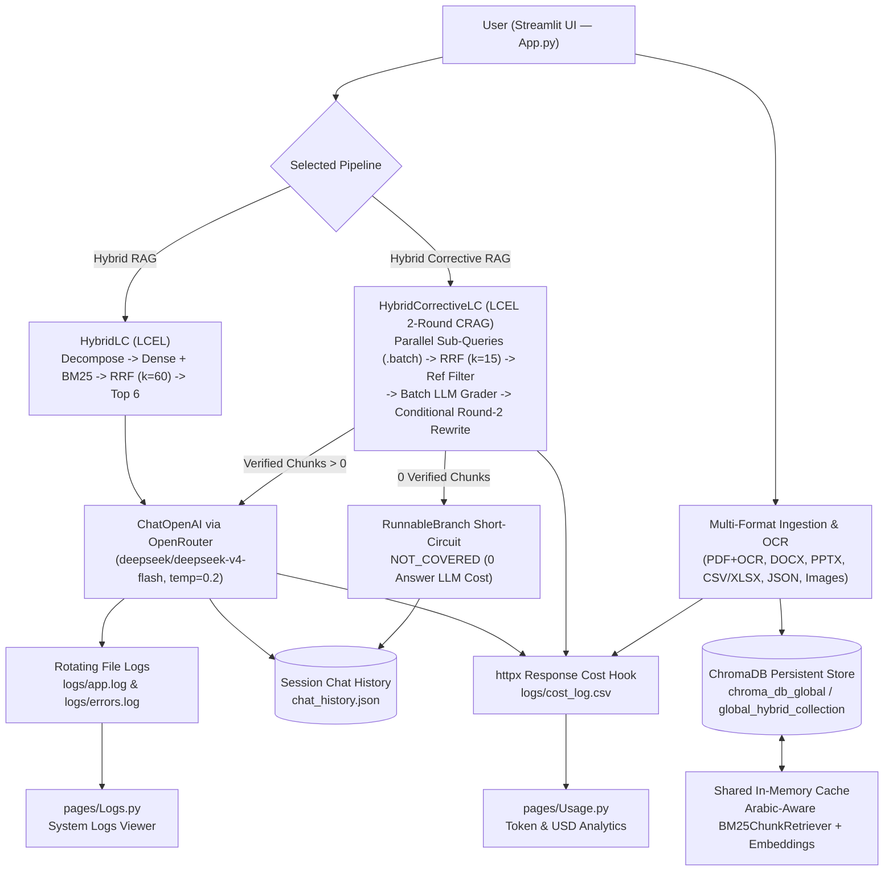

# Enterprise Bilingual Hybrid & Corrective RAG System (LangChain LCEL)

[](https://www.python.org/)
[](https://python.langchain.com/)
[](https://streamlit.io/)
[](https://www.trychroma.com/)
[](./Dockerfile)

A production-oriented, **bilingual (English & Arabic)** Retrieval-Augmented Generation (RAG) platform powered by **LangChain Expression Language (LCEL)**, **ChromaDB**, and **Arabic-aware BM25 + Reciprocal Rank Fusion (RRF)**, served through a multi-page **Streamlit** web application with real-time token/USD cost analytics, multi-session chat management, OCR-backed multi-format document ingestion, and full Docker support.

> **Active Branch (`langchain`):** The Streamlit application (`App.py`) runs directly on the **LangChain LCEL** pipelines (`HybridLC` and `HybridCorrectiveLC` under `hybrid_rag/lc/`), while keeping the native OpenAI-SDK reference implementations (`hybrid_rag/hybrid.py` and `hybrid_rag/hybrid_corrective.py`) available for parity testing and shared indexing/caching.

---

## Table of Contents

- [Key Capabilities](#key-capabilities)
- [System Architecture](#system-architecture)
- [RAG Pipelines (LangChain LCEL)](#rag-pipelines-langchain-lcel)
  - [1. Hybrid RAG (`HybridLC`)](#1-hybrid-rag-hybridlc)
  - [2. 2-Round Fused Hybrid Corrective RAG (`HybridCorrectiveLC`)](#2-2-round-fused-hybrid-corrective-rag-hybridcorrectivelc)
- [Multi-Format Ingestion & Bilingual OCR](#multi-format-ingestion--bilingual-ocr)
- [Streamlit Multi-Page Application](#streamlit-multi-page-application)
- [Observability: Cost Tracking, Retries & Logging](#observability-cost-tracking-retries--logging)
- [Benchmark Evaluation Results (120 Bilingual Questions)](#benchmark-evaluation-results-120-bilingual-questions)
- [Project Structure](#project-structure)
- [Getting Started](#getting-started)
  - [Local Setup](#local-setup)
  - [Docker Deployment](#docker-deployment)
- [Repository Branch Map](#repository-branch-map)
- [Technology Stack](#technology-stack)

---

## Key Capabilities

- **Dual LangChain LCEL Pipelines:** Switch live in the UI between **Hybrid RAG (`HybridLC`)** for fast, low-cost retrieval and **Hybrid Corrective RAG (`HybridCorrectiveLC`)** for high-precision, self-correcting 2-round CRAG with zero-cost refusal short-circuiting.
- **Bilingual English & Arabic Retrieval:** Combines semantic dense embeddings (`openai/text-embedding-3-small`) with an Arabic-aware `BM25ChunkRetriever` (diacritic/tatweel removal, Alef/Ya normalization) fused via Reciprocal Rank Fusion (`k = 60`), achieving **0.00% cross-lingual bleed** on CRAG across a 10-book mixed corpus.
- **15 Supported File Formats + OCR:** Ingests unstructured documents (`PDF` with automatic Tesseract `ara+eng` OCR fallback for scanned books, `DOCX`, `PPTX`, `TXT`, `MD`, and images) alongside structured datasets (`CSV`, `XLSX`, `XLS`, `JSON`) with smart row-batching and structured-data protection.
- **Source & Location Grounding:** Every retrieved chunk carries rich metadata (`Page`, `Slide`, `Sheet/Rows`, `Table`, `Records`, `Section`, or `Image`) enforced by the system prompt for verifiable citations.
- **Multi-Session Chat & Flexible History Summarization:** Create new chats (`+ New Chat`), switch between saved conversations, delete individual chats or clear all history, and summarize the active chat, any custom subset of chats, or all chats at once.
- **Real-Time Cost & Token Dashboard (`Usage`):** Automatically intercepts every OpenRouter HTTP response (including LangChain calls, embeddings, CRAG grading, and history summaries), logs exact token counts and USD charges to `logs/cost_log.csv`, and cross-checks against live OpenRouter API key/account credits.
- **In-App System Logs Viewer (`Logs`):** Inspect rotating `logs/app.log` and `logs/errors.log` directly in Streamlit with multiline stack-trace grouping, severity filtering, keyword search, and download.
- **Production Multi-Stage Docker Build:** Ships with Python 3.13, `uv`, Tesseract OCR (`ara` + `eng`), Poppler (`pdftoppm`), a non-root `appuser`, healthchecks, and a one-command Windows rebuild script (`rebuild.ps1`) that preserves vector stores, logs, and chat history.

---

## System Architecture



---

## RAG Pipelines (LangChain LCEL)

Both pipelines live in `hybrid_rag/lc/` and share a unified foundation in [`hybrid_rag/lc/components.py`](hybrid_rag/lc/components.py):

- **Single Shared Chroma Client & BM25 Cache:** Wraps `hybrid_rag/hybrid.py`'s `chroma_client` and `GLOBAL_BM25_CACHE` so chunks, IDs, and embeddings are loaded into memory once with zero client contention.
- **Custom `BM25ChunkRetriever(BaseRetriever)`:** Integrates `rank_bm25.BM25Okapi` with Arabic-aware tokenization (strips harakat/tatweel `[\u064B-\u065F\u0670\u0640]`, normalizes `أ/إ/آ/ٱ -> ا` and `ى -> ي`) and caches retrievers per `(corpus_count, file_filter, k)`.
- **Unified Cost Tracking Hook:** Both `ChatOpenAI` and `OpenAIEmbeddings` attach the same `httpx` response event hook (`record_cost`) used by the native pipelines, ensuring 100% cost visibility across every step.
- **File-Scope Filtering:** Selecting specific files in the sidebar applies synchronized filtering to both ChromaDB (`{"source": {"$in": [...]}}`) and the in-memory `BM25ChunkRetriever`.

### 1. Hybrid RAG (`HybridLC`)

Implemented in [`hybrid_rag/lc/hybrid_lc.py`](hybrid_rag/lc/hybrid_lc.py) as a composable LCEL chain (`build_chain()`):

1. **Multi-Question Decomposition:** Splits compound or numbered user prompts into focused sub-questions (`decompose_multi_questions`).
2. **Dual Retrieval + RRF:** For each sub-question, runs dense vector search (`Chroma.similarity_search`, `k = 10`) and sparse keyword search (`BM25ChunkRetriever`, `k = 10`), then merges all ranked lists with Reciprocal Rank Fusion (`RRF_K = 60`) and selects the top `top_k = 6` unique chunks. If dense search fails transiently, it gracefully degrades to BM25 results.
3. **Context & Session Memory Assembly:** Formats chunks with source/location headers (`[Source: <file> | <location>]`) and loads the rolling window of the last `5` turns for the active `session_id`.
4. **Generation & Persistence:** Executes `ANSWER_PROMPT | get_llm(temperature=0.2) | StrOutputParser()` and persists the turn to `chat_history.json` under the active session.

### 2. 2-Round Fused Hybrid Corrective RAG (`HybridCorrectiveLC`)

Implemented in [`hybrid_rag/lc/hybrid_corrective_lc.py`](hybrid_rag/lc/hybrid_corrective_lc.py) as an adaptive, self-correcting LCEL workflow:

1. **Parallel Sub-Query Execution:** Decomposes multi-part queries and executes the 2-round CRAG loop across sub-questions concurrently using `RunnableLambda(corrective_retrieve_sub_query).batch(..., config={"max_concurrency": 4})`.
2. **Round 1 — Wide Hybrid RRF Retrieval:** Fetches `INITIAL_CANDIDATES = 15` candidates via `search_hybrid_rrf_lc` (Chroma vector search + `BM25ChunkRetriever` + RRF), computes exact cosine similarity against cached embeddings, and enforces `MIN_SIMILARITY = 0.05`.
3. **Deterministic Reference-List Pre-Filter:** Automatically filters bibliography/reference-list noise chunks (`citation_density >= 12`) before grading — while explicitly exempting structured tabular/JSON chunks (`data_kind == "structured"`).
4. **Single-Call LCEL Batch Grader:** Evaluates all remaining candidates in a single structured JSON call (`BATCH_GRADER_PROMPT | get_llm(temperature=0.0, disable_reasoning=True) | StrOutputParser()`) to identify:
   - Which candidates contain facts answering the question.
   - Whether all sub-parts of the question are sufficiently covered (`sufficient: true/false`).
   - Any missing aspects (`missing`) and up to 3 targeted corrective search queries (`queries`).
5. **Round 2 — Conditional Corrective Search:** Triggered *only* when Round 1 is insufficient. Batch-embeds the grader's rewritten queries, retrieves `EXTRA_PER_QUERY = 4` new candidates per query, deduplicates against Round 1, filters references/low-similarity noise, and re-grades the merged pool (`MAX_GRADED = 16`).
6. **Zero-Cost Short-Circuit & Grounded Generation:** Merges deduplicated verified chunks sorted by cosine similarity (capped at `MAX_CONTEXT = 6`). An LCEL `RunnableBranch`:
   - **Short-circuits** immediately with `NOT_COVERED` (**0 Answer LLM cost**) if no verified chunks survive grading.
   - Otherwise injects any detected `missing` note into the system prompt so the Answer LLM answers supported parts while transparently stating what the documents do not cover.

---

## Multi-Format Ingestion & Bilingual OCR

Handled by [`hybrid_rag/file_processing.py`](hybrid_rag/file_processing.py) and indexed into `chroma_db_global` via `initialize_hybrid_index()` in [`hybrid_rag/hybrid.py`](hybrid_rag/hybrid.py):

| Category | Supported Extensions | Extraction & Chunking Strategy | Citation Location Format |
| :--- | :--- | :--- | :--- |
| **PDF Documents** | `.pdf` | `pypdf` text extraction with automatic per-page OCR fallback (`pdf2image`/Poppler or PyMuPDF + Tesseract `ara+eng`) for scanned or low-text pages; `RecursiveCharacterTextSplitter` | `Page N` |
| **Office Documents** | `.docx`, `.pptx` | Paragraphs & tables (`python-docx`), slide text & tables (`python-pptx`) | `Section N`, `Table N`, `Slide N` |
| **Plain Text & Markdown** | `.txt`, `.md` | UTF-8 text loading with recursive overlapping chunking | `Section N` |
| **Standalone Images** | `.png`, `.jpg`, `.jpeg`, `.tiff`, `.bmp`, `.webp` | Direct bilingual Tesseract OCR (`ara+eng`) | `Image` |
| **Spreadsheets & CSV** | `.csv`, `.xlsx`, `.xls` | Smart row-batching preserving column headers per chunk (`data_kind="structured"`) | `Sheet <name>, Rows A-B` |
| **Structured JSON** | `.json` | Schema-aware record/key chunking (`data_kind="structured"`) | `Records A-B` / `Key <name>` |

Additional indexing features:
- **Duplicate Detection:** Checks already-indexed source filenames before re-embedding and skips duplicates cleanly.
- **Batch Embeddings with Progress UI:** Sends batched embedding requests to OpenRouter with live Streamlit progress updates and fail-fast handling for non-retryable `4xx` API errors.
- **High-Throughput Scanned PDF OCR:** Supports multi-threaded OCR (`OMP_THREAD_LIMIT=1` prevents Tesseract OpenMP thread contention inside Docker/Linux containers).

---

## Streamlit Multi-Page Application

The UI uses a clean sky-blue theme (`primaryColor = "#0EA5E9"` in [`.streamlit/config.toml`](.streamlit/config.toml)) with automatic Light/Dark mode compatibility across three pages:

1. **Main Chat Workspace ([`App.py`](App.py)):**
   - **Knowledge Base Manager:** Upload one or multiple files into the shared global ChromaDB collection, monitor live indexing progress, restrict queries to specific files via multiselect, or delete individual files from the vector index.
   - **Query Architecture Toggle:** Switch seamlessly between **Hybrid RAG** (`run_hybrid_lc`) and **Hybrid Corrective RAG** (`run_hybrid_corrective_lc`).
   - **Multi-Session Conversations:** Start fresh threads (`+ New Chat`), switch between saved conversations (ordered by most recent activity with turn counts), delete the active chat, or wipe all history.
   - **Flexible History Summarization:** Summarize the current chat, pick multiple specific chats, or leave the selector empty to generate a consolidated summary across all saved sessions (`hybrid_rag/summarizer.py`).
   - **Transparent Evidence & Cost Display:** Every assistant reply displays an expandable **Retrieved Context Chunks** viewer and a per-answer cost caption (API requests, input/output/reasoning tokens, and exact USD spend).
2. **Usage & Cost Analytics ([`pages/Usage.py`](pages/Usage.py)):**
   - Interactive OpenRouter-style activity dashboard reading `logs/cost_log.csv`.
   - Headline KPIs: **Total spend**, **Requests**, **Tokens** (input / output / reasoning breakdown), **Questions**, and **Avg cost / question**.
   - Live OpenRouter account verification (API key spend/limit and remaining account credits, cached 5 minutes).
   - Period (`24h`, `7d`, `30d`, `All time`), chat model, and pipeline pill filters driving Altair stacked bar charts (spend & tokens over time, per-pipeline comparison, and per-step breakdown).
3. **System Logs Viewer ([`pages/Logs.py`](pages/Logs.py)):**
   - Live inspector for `logs/app.log` and `logs/errors.log` with severity counters (`Total`, `Errors/Critical`, `Warnings`, `Info`), level multiselect, keyword search, multiline Python traceback grouping, tail size control, newest-first toggle, and one-click file download.

---

## Observability: Cost Tracking, Retries & Logging

| Subsystem | Module / Config | Details |
| :--- | :--- | :--- |
| **Cost Tracking** | `hybrid_rag/cost.py` | Thread-local context manager `cost.track(system, query)` paired with an `httpx` response hook. Records per-step requests, prompt/completion/reasoning tokens, and OpenRouter billed USD into `logs/cost_log.csv` (falls back to cached OpenRouter pricing in `logs/model_prices.json` if usage cost is omitted). |
| **Resilient Retries** | `hybrid_rag/retry.py` | Exponential-backoff retry wrapper (`execute_with_retry`) for transient rate limits (`429`), timeouts, and connection hiccups while failing fast on permanent `4xx` errors. |
| **Structured Logging** | `hybrid_rag/logging_setup.py`, `config/logging_config.json` | Idempotent `dictConfig` initialization writing clean console output (`INFO`), rotating `logs/app.log` (`5 MB × 5` backups), and rotating `logs/errors.log` (`5 MB × 3` backups, `ERROR+`), while suppressing verbose third-party loggers (`httpx`, `httpcore`, `openai`, `chromadb`, `urllib3`, `PIL`, `watchdog`). |

---

## Benchmark Evaluation Results (120 Bilingual Questions)

Both LangChain LCEL pipelines were evaluated end-to-end on a **120-question mixed bilingual benchmark** (**60 English Native PDF questions + 60 Arabic Scanned OCR PDF questions** across 6 books), searching **globally across all 10 indexed PDFs (`6,343` chunks)** in `chroma_db_global`:

- **Models:** Embeddings `openai/text-embedding-3-small` (1536 dims) · Answer & CRAG Grader LLM `deepseek/deepseek-v4-flash` · Gold-Standard RAGAS & Accuracy Judge `deepseek/deepseek-v4-flash` (reasoning enabled).
- **Protocol:** Every question evaluated standalone (`history=[]`) without mutating production `chroma_db_global` or `chat_history.json`.

### Evaluation 1 — Pre-LLM Retrieval Quality (Chunks Handed to Answer LLM)

| Metric | `HybridLC` (LCEL RRF) | `HybridCorrectiveLC` (LCEL 2-Round CRAG) | Advantage |
| :--- | :---: | :---: | :---: |
| Avg Chunks Returned (`K`) | `6.00` | **`2.64`** | `HybridCorrectiveLC` (-56% context size) |
| Document Accuracy (`Source Hit@K`) | **`100.0%`** | `98.3%` | `HybridLC` |
| Document Precision (Right-PDF %) | `96.9%` | **`97.6%`** | `HybridCorrectiveLC` |
| **Cross-Lingual Bleed (%)** | `0.28%` | **`0.00%`** | `HybridCorrectiveLC` |
| Deterministic `Fact Hit@K` / `Full Coverage` | `90.8%` / `80.8%` | **`93.3%`** / **`84.2%`** | `HybridCorrectiveLC` |
| Deterministic `Precision@K` / `MRR` / `nDCG@K` | `37.5%` / `0.81` / `0.80` | **`76.1%`** / **`0.86`** / **`0.88`** | `HybridCorrectiveLC` |
| **Gold RAGAS Context Precision (Mean / AP)** | `33.2%` (`78.0%`) | **`84.1%`** (**`93.4%`**) | `HybridCorrectiveLC` (**+50.9 pp**) |
| **Gold RAGAS Context Recall (Mean / Full)** | `86.2%` (`78.3%`) | **`90.8%`** (**`85.0%`**) | `HybridCorrectiveLC` (**+4.6 pp**) |
| Pre-LLM Retrieval Latency / Total Cost (120 Qs) | **`2.9s`** / **`$0.00405`** | `5.8s` / `$0.07437` | `HybridLC` |

> **CRAG Grader Impact (`HybridCorrectiveLC` Pre-Grading `k=15` vs Post-Grading `k=2.64`):** Removed **94.0%** of irrelevant noise chunks, increased Deterministic `Precision@K` by **+47.8 pp** (`28.3% -> 76.1%`), eliminated cross-lingual bleed (`0.06% -> 0.00%`), and triggered Round-2 corrective searches in only **8 / 120 questions (6.7%)**.

### Evaluation 2 — End-to-End LLM Answers & Gold-Standard Judge

| Metric | `HybridLC` (LCEL RRF) | `HybridCorrectiveLC` (LCEL 2-Round CRAG) |
| :--- | :---: | :---: |
| **Answer Accuracy (Points / 240)** | `202 / 240` (**84.2%**) | **`211 / 240` (87.9%)** |
| Breakdown (`2/2` Correct · `1/2` Partial · `0/2` Wrong) | `89` / `24` / `7` | **`96`** / `19` / **`5`** |
| **Faithfulness** (Zero Hallucinations) | `97.5%` | **`98.3%`** |
| **Citation Accuracy** (Non-Refusal) | `97.5%` | **`99.2%`** |
| **False Refusals** (Full / Partial) | `4` / `5` | **`2`** / **`1`** |
| **Head-to-Head Wins (120 Qs)** | `5` wins | **`11` wins** (`104` ties) |
| Avg API Requests / End-to-End Latency per Q | **`3.2` req** · **`9.0s`** | `4.5` req · `11.2s` |
| Total Cost (120 Qs) / Avg Cost per Question | **`$0.03823`** (**`$0.00032/Q`**) | `$0.09657` (`$0.00080/Q`) |

### English (Native PDFs) vs Arabic (Scanned OCR PDFs) Breakdown

| Subset | Pipeline | Answer Accuracy (`2/1/0`) | RAGAS CtxPrec / CtxRecall | Faithfulness / Citations | False Refusals (F/P) |
| :--- | :--- | :---: | :---: | :---: | :---: |
| **English (60 Qs, Native)** | `HybridLC` | `93.3%` (`53/6/1`) | `38.9%` / `94.7%` | `96.7%` / `98.3%` | `0 / 0` |
| **English (60 Qs, Native)** | `HybridCorrectiveLC` | **`95.8%`** (`55/5/0`) | **`91.4%`** / **`99.2%`** | **`100.0%`** / **`100.0%`** | `0 / 0` |
| **Arabic (60 Qs, Scanned OCR)** | `HybridLC` | `75.0%` (`36/18/6`) | `27.5%` / `77.7%` | `98.3%` / `96.6%` | `4 / 5` |
| **Arabic (60 Qs, Scanned OCR)** | `HybridCorrectiveLC` | **`80.0%`** (`41/14/5`) | **`76.9%`** / **`82.4%`** | `96.7%` / **`98.3%`** | **`2 / 1`** |

### Per-Document Accuracy (6 Books × 20 Questions)

| Document | Language / Source Type | `HybridLC` Accuracy | `HybridCorrectiveLC` Accuracy |
| :--- | :--- | :---: | :---: |
| Cultured Meat (`Advice For Risk Associated with Cultured Meat.pdf`) | EN · Native PDF | `97.5%` | **`97.5%`** |
| Bishop PRML (`Bishop-Pattern-Recognition-and-Machine-Learning-2006.pdf`) | EN · Native PDF | `95.0%` | **`97.5%`** |
| Battery Technology (`HummesETAL_Lajer_2023-2.pdf`) | EN · Native PDF | `87.5%` | **`92.5%`** |
| Refutation of the Logicians (`الرد على المنطقيين`) | AR · Scanned OCR | `80.0%` | **`90.0%`** (+10.0 pp) |
| Nutritional Culture (`الثقافة الغذائية`) | AR · Scanned OCR | `82.5%` | **`87.5%`** (+5.0 pp) |
| Andalusian History (`التاريخ الأندلسي`) | AR · Scanned OCR | `62.5%` | **`62.5%`** |

---

## Project Structure

```text
RAGs-Project/
├── App.py                             # Main Streamlit chat UI (wired to HybridLC & HybridCorrectiveLC)
├── pages/
│   ├── Usage.py                       # Real-time OpenRouter token & USD spend analytics dashboard
│   └── Logs.py                        # In-app viewer for rotating app.log & errors.log
├── hybrid_rag/
│   ├── lc/                            # LangChain LCEL implementation (active in App.py on this branch)
│   │   ├── __init__.py
│   │   ├── components.py              # Shared ChatOpenAI, OpenAIEmbeddings, Chroma, BM25ChunkRetriever, RRF, prompts
│   │   ├── hybrid_lc.py               # Hybrid RAG LCEL chain (run_hybrid_lc)
│   │   └── hybrid_corrective_lc.py    # 2-Round Fused CRAG LCEL chain (run_hybrid_corrective_lc)
│   ├── hybrid.py                      # Shared ChromaDB collection, Arabic-aware BM25 cache, batch indexing & native Hybrid RAG
│   ├── hybrid_corrective.py           # Shared CRAG constants/grader prompt/parser & native 2-Round CRAG implementation
│   ├── file_processing.py             # 15-format extraction, bilingual Tesseract OCR, smart row-batching, query decomposition
│   ├── chat_history.py                # Multi-session persistent conversation store (chat_history.json)
│   ├── summarizer.py                  # Single-, multi-, and all-chat conversation history summarizer
│   ├── cost.py                        # Thread-local request/token/USD tracker (logs/cost_log.csv)
│   ├── retry.py                       # Exponential-backoff retry utility for transient API errors
│   └── logging_setup.py               # Idempotent rotating file & console logging setup
├── config/
│   └── logging_config.json            # Python logging dictConfig (console + rotating app.log & errors.log)
├── .streamlit/
│   └── config.toml                    # Sky-blue UI theme (#0EA5E9) with automatic Light/Dark mode
├── Dockerfile                         # Multi-stage Python 3.13 + uv + Tesseract (ara+eng) + Poppler + non-root appuser
├── docker-compose.yml                 # Docker Compose service with persistent ChromaDB volume & healthcheck
├── rebuild.ps1                        # One-command safe Windows Docker rebuild & restart script
├── pyproject.toml                     # Project metadata & dependency specification
├── requirements.txt                   # Core Python dependencies
├── requirements-ocr.txt               # Lightweight OCR Python layer (pytesseract, pdf2image, Pillow)
├── documents/                         # Sample PDF documents
└── [local runtime / gitignored]
    ├── .env                           # API key and model configuration
    ├── chroma_db_global/              # Persistent global ChromaDB vector store
    ├── chat_history.json              # Multi-session conversation history
    ├── logs/                          # app.log, errors.log, cost_log.csv, model_prices.json
    └── evaluation/                    # Local benchmark scripts, datasets, and generated .md/.docx reports
```

---

## Getting Started

### Prerequisites

- **Python 3.13+** and **[uv](https://docs.astral.sh/uv/)** (or Docker Desktop for containerized execution)
- An **[OpenRouter](https://openrouter.ai/)** API key
- *(Optional for local scanned-PDF OCR)* **Tesseract OCR** (with `ara` and `eng` traineddata) and **Poppler** — already pre-installed in the Docker image.

### Local Setup

1. **Clone the repository and switch to the `langchain` branch:**
   ```bash
   git clone <repository-url>
   cd RAGs-Project
   git checkout langchain
   ```

2. **Create a virtual environment and install dependencies:**
   ```powershell
   uv venv
   uv pip install -r requirements.txt
   uv pip install -r requirements-ocr.txt
   ```

3. **Create a `.env` file in the project root:**
   ```env
   OPENROUTER_API_KEY=sk-or-v1-...
   CHAT_MODEL=deepseek/deepseek-v4-flash
   EMBEDDING_MODEL=openai/text-embedding-3-small
   ```
   > **Note:** All three environment variables are required. The pipelines intentionally avoid silent model defaults so every environment explicitly declares its embedding and chat models.

4. **Launch the Streamlit application:**
   ```powershell
   .\.venv\Scripts\python.exe -m streamlit run App.py
   ```
   Open **http://localhost:8501** in your browser.

---

### Docker Deployment

#### Option A — Recommended Single-Command Rebuild (Windows PowerShell)

```powershell
.\rebuild.ps1
```

What `rebuild.ps1` does automatically:
- Ensures `chroma_db_global/`, `logs/`, and `chat_history.json` exist on the host.
- Builds the multi-stage `rags_img` Docker image (with Tesseract `ara+eng` and Poppler pre-installed).
- Stops and replaces `global_rag_app` **only if the build succeeds**.
- Mounts `.env` (read-only) plus `chroma_db_global/`, `logs/`, and `chat_history.json` so your indexed knowledge base, cost logs, and chat history persist across rebuilds.
- Applies `chown -R appuser:appuser` on mounted writable paths to prevent SQLite permission errors (`code 14`) on Windows/WSL2 mounts.

#### Option B — Docker Compose

```bash
docker compose up -d --build
```

The app will be available at **http://localhost:8501** with a built-in healthcheck at `/_stcore/health`.

---

## Repository Branch Map

| Branch | Active Pipelines in `App.py` | Purpose |
| :--- | :--- | :--- |
| **`langchain`** *(current)* | `HybridLC` & `HybridCorrectiveLC` (`hybrid_rag/lc/`) | Production Streamlit app running on composable LangChain LCEL chains with full bilingual OCR, multi-session chat, cost dashboard, and logs viewer. |
| **`refactor/hybrid-cleanup`** | Native `Hybrid RAG` & `Hybrid Corrective RAG` (`hybrid_rag/`) | Clean native OpenAI-SDK implementation with identical UI, multi-session chat, cost tracking, and logs viewer. |
| **`feat/all-rags-unified`** | Extended multi-RAG suite | Experimental branch combining Hybrid, Corrective, Basic, Hierarchical, and Parent-Child RAG variants. |

---

## Technology Stack

| Layer | Technologies |
| :--- | :--- |
| **Orchestration & Chains** | LangChain (`langchain-core`, `langchain-openai`, `langchain-chroma`, `langchain-text-splitters`) |
| **Models & Inference** | OpenRouter API · `deepseek/deepseek-v4-flash` (Chat & CRAG Grader) · `openai/text-embedding-3-small` (1536-dim Embeddings) |
| **Retrieval & Storage** | ChromaDB (`PersistentClient`) · `rank-bm25` (`BM25Okapi` with Arabic normalization) · Reciprocal Rank Fusion (`RRF`) |
| **Document Processing & OCR** | `pypdf` · `python-docx` · `python-pptx` · `openpyxl` · `pytesseract` · `pdf2image` · Poppler · Tesseract (`ara` + `eng`) |
| **Frontend & Visualization** | Streamlit `1.67+` · Altair · Pandas |
| **Runtime & DevOps** | Python `3.13` · `uv` · Docker (multi-stage non-root build) · Docker Compose |
